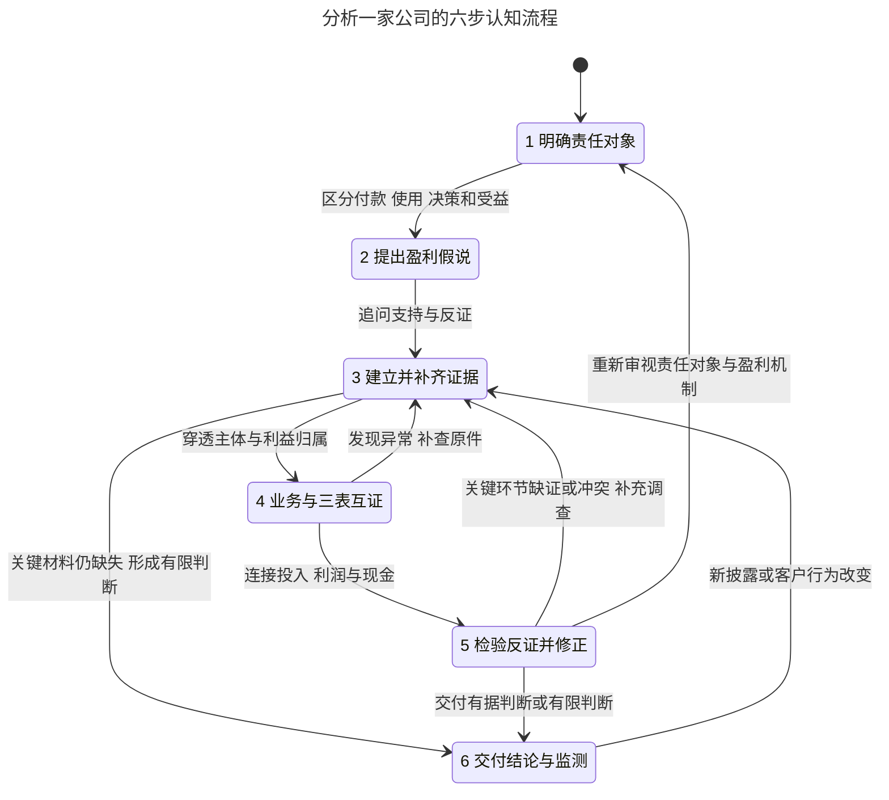

# 六步研究流程

用于完整公司研究与盈利模式解释。六步是认知循环，研究深度随问题与重大性调整；CLI负责可重复操作，AI负责意义、因果和证据是否充分。

[六步SVG](../assets/statecharts/six-step.svg) · [Mermaid源文件](../assets/statecharts/six-step.mmd)

| 步骤 | AI要形成的结果 | 继续或回退依据 |
| --- | --- | --- |
| 1 明确责任对象 | 研究范围与角色关系：谁决策、付款、使用、受益，企业承诺什么，谁承担成本 | 按重要业务分开；承诺、付款动机和实际受益分别取证 |
| 2 提出盈利假说 | 为什么选它、凭什么交付、全成本之后利润为何留下、下一笔订单从哪来 | 写出最强替代解释，以及区分两种解释所需的证据 |
| 3 建立并补齐证据 | 问题到行业术语、主体、PDF章节、原页和外部旁证的地图 | 先查库和复用匹配读稿；补未覆盖正文附注。来源失败换来源，未命中扩搜 |
| 4 业务与三表互证 | 穿透主体；解释资产战略、正常利润来源、持续可用现金，以及资本配置和回报 | 连接交付、投入、利润、现金和分配；任一表异常即可回第3步 |
| 5 检验反证并修正 | 比较主解释与竞争解释，核查时间、口径、归属及未解释的变化 | 缺材料回第3步；机制失效回第1—2步；关键缺口仍在则缩小判断范围 |
| 6 交付结论与监测 | 分别说明集团经营质量、母公司支付能力、股东实际回报，附依据、缺口及失效条件 | 新披露或客户行为改变后重查；正面或负面判断都需要证据 |

六步简图将“已有依据”和“仍有关键缺口”合并到交付节点，详细版分别展开。确认“尚不能判断”也可以结束当前问题，但应指出缺什么、影响哪条结论、什么新证据会改变判断。

## 按问题展开

- **客户、交付与分利**：读[客户价值与盈利机制](customer-value.md)。
- **新公司、PDF非三表内容、冲突与回退**：读[详细认知流程与证据地图](research-statechart.md)。
- **母子、资产战略、利润、现金与交付格式**：查[分析指南](analysis-guide.md)对应章节。
- **执行与接续**：命令查 `cfa.py --help`；正式产物和发现查[案例与发现](case-workflow.md)，复用及查询查[证据检索](index-workflow.md)。

六步图是已检查有限模型的简化投影，折叠321个同标签转换，包括范围确认、通读、各表判断、证据评估及等待。实际研究可多轮；图的规则相容不证明披露真实、阅读充分或解释正确。重建方式见[模型说明](statechart-models.md)，公司研究无需运行图形建模工具。
