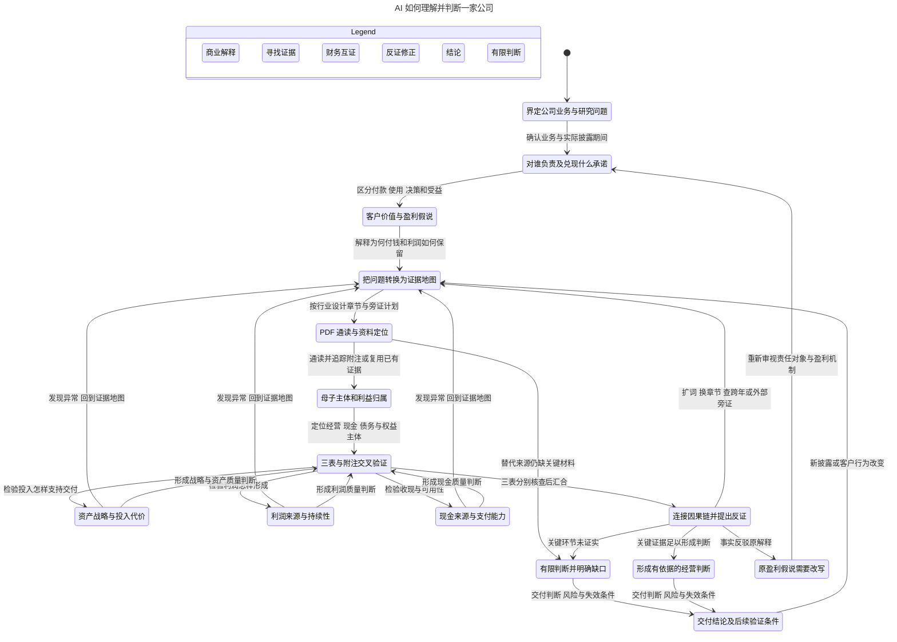

# 详细认知流程与证据地图

用于新公司研究、定位PDF正文与附注、检索不足或解释冲突。先用[六步总览](research-process.md)确定问题所在环节，再按下图展开；具体财务口径沿用[分析指南](analysis-guide.md)，客户效果与分利判断沿用[客户价值与盈利机制](customer-value.md)。

目录：[认知图](#认知图) · [状态输出](#每次转换究竟想明白了什么) · [新公司证据发现](#新公司怎样找到pdf中三表之外的重要内容) · [程序与判断的边界](#程序与判断的边界)

## 认知图

[详细SVG](../assets/statecharts/reasoning.svg) · [Mermaid源文件](../assets/statecharts/reasoning.mmd)

三表按研究问题选择先后。任一表出现疑点，可以立即回证据地图、原页或主体关系；综合判断需连通责任兑现、投入、利润、现金和分配。

补查与改写是两种转换：信息不足时扩展来源；事实反驳机制时，重新审视责任对象与盈利假说。有依据的判断可以是正面或负面；有限判断限定未知环节，不等于公司质量差。

## 每次转换究竟想明白了什么

| 认知状态 | 必须回答的问题与证据 | 阶段结论 | 继续或回退条件 |
| --- | --- | --- | --- |
| 界定公司与问题 | 哪个上市主体、业务、期间和口径？完整研究还是局部问题？报告是否更正重述？ | 研究范围、实际已披露期间、比较边界 | 身份和期间不清，先查范围 |
| 对谁负责及承诺 | 谁决策、付款、使用、受益？谁承担库存、资金、售后与外部成本？宣传、合同与实际效果是否一致？ | 按业务建立责任及价值关系 | 缺少实际效果证据，保留履责假说 |
| 提出盈利假说 | 为什么付钱、为什么选它？企业凭什么交付并保留全成本利润？下一笔订单从哪来？ | 可反驳的盈利解释及竞争解释 | 解释不了价值创造与获取，就重新分业务、辨角色 |
| 建立证据地图 | 什么事实支持或推翻哪句话？应在哪些章节、附注、主体和外部来源？ | 问题—来源—原页—支持/反驳—缺口 | 不能只列下载清单，要解释材料解决哪个判断 |
| 通读PDF并定位 | 业务、经营讨论、治理、重大事项及财务报告讲了什么？附注怎样改变表面理解？ | 基础读稿、重要披露、跨年变化及未知事项 | 搜不到先诊断；合理替代来源仍不足才形成有限判断 |
| 母子及利益归属 | 谁经营、赚钱、持有现金、欠债？权益归谁？钱能否及是否实际上划？ | 经营、资金、风险主体与上市股东权益关系 | 不能把合并减母公司当作真实子公司业绩 |
| 资产战略 | 投入怎样支持交付？内生建设、并购还是投资？代价、时滞、质量和资金期限怎样？ | 增长路径、投入效率、增长代价与融资脆弱性 | 与产能、订单、利润冲突，回项目和减值披露 |
| 利润质量 | 产品经营、资金、政策、周期和估计变化各贡献什么？全成本充分吗？ | 正常利润来源、持续条件、归属及扭曲因素 | 变化解释不了，回价格、结构、返利、减值和政策 |
| 现金质量 | 客户交付、营运资金释放、占款、金融本金、融资或处置各贡献什么？谁可用、应履行什么义务？ | 持续可用现金、必要支出与分配约束 | 来源或可用性不清，回收入、往来、财务公司及受限安排 |
| 联合解释并反证 | 客户、资产、利润、现金与分配能否跨时间和主体接起来？其他解释能否同样说明数字？ | 主解释、替代解释、冲突证据及判断边界 | 材料不足回证据地图；机制被推翻回责任与盈利假说 |
| 交付当前判断 | 哪些已知、哪些未知？什么事实会改变结论？ | 集团质量、母公司支付能力、股东回报、风险与监测条件 | 新披露或客户行为变化后重新研究 |

已有研究可以复用，但要核准来源版本、问题范围和依赖仍成立。旧结论不会因为存入SQLite就自动成为新时期事实。

## 新公司怎样找到PDF中三表之外的重要内容

先认识业务和价值链，再建立这家公司的术语、主体和章节地图。完整年报、半年报正文及附注是核心；季报不能替代未更新的明细。

[打开证据发现SVG](../assets/statecharts/evidence.svg) · [Mermaid源文件](../assets/statecharts/evidence.mmd)

```mermaid
---
title: "新公司怎样发现三表之外的业务证据"
---
stateDiagram-v2
  state "Legend" as legend {
    lg0: 问题定义
    lg1: 原件与阅读
    lg2: 证据调查
    lg3: 解释评估
    lg4: 判断有据
    lg5: 明确缺口
  }
  class lg0 blue
  class lg1 purple
  class lg2 teal
  class lg3 orange
  class lg4 teal
  class lg5 yellow
  s0: 按业务问题建立公司与行业词图
  s1: 查询SQLite定位既有证据
  s2: 通读业务治理重大事项与重要附注
  s3: 获取并核验原始PDF
  s4: 改查公司或交易所原始披露
  s5: 按语义主体及同义词定位
  s6: 扩展目录邻页OCR与其他年度 限一轮
  s7: 形成有限判断并记录证据缺口
  s8: 核对原页附注口径与跨年变化
  s9: 比较盈利解释履责证据与替代解释
  s10: 补客户监管等原始旁证
  s11: 形成有依据的业务与履责判断
  [*] --> s0
  s0 --> s1: 明确谁付款使用受益及承诺
  s1 --> s2: 复用已核验原件 [缓存命中]
  s1 --> s3: 取得对应期间原件 [未命中或版本失效]
  s2 --> s5: 先理解业务及非三表事项
  s3 --> s4: 保留失败并更换原始来源
  s3 --> s2: 核对主体期间版本与来源
  s4 --> s7: 记录缺失期间和影响 [无可核验原件]
  s4 --> s2: 核验替代来源原件
  s5 --> s6: 未命中只表示尚未定位
  s5 --> s8: 找到候选证据
  s6 --> s9: 保留检索范围和缺口 [仍未定位]
  s6 --> s8: 扩搜找到相关章节
  s8 --> s9: 核准交付效果并辨明证据边界
  s8 --> s6: 重查语义主体与年度 [本轮尚未扩搜]
  s8 --> s10: 实际效果须从客户或监管补证
  s9 --> s7: 写明缺口及可能改变判断的证据
  s9 --> s11: 连接事实推断及失效条件
  s10 --> s9: 核对旁证质量与适用边界
  class s0 blue
  class s1 blue
  class s2 purple
  class s3 purple
  class s4 purple
  class s5 teal
  class s6 teal
  class s7 yellow
  class s8 teal
  class s9 orange
  class s10 teal
  class s11 teal
```

这张补充图展开一个业务问题的证据调查，假设该期核心理解尚待完成：缓存命中仍需完成PDF核心理解；未命中先扩搜；原件获取失败先换原始来源；客户效果缺证则限制履责结论。有依据的客户效果判断可以是正面或负面。图中的一轮扩搜只是检查边界。

同版本且问题范围匹配的完整读稿可以复用，随后回核关键原页、核准新增披露和变化；不要求每次查询都重读整批PDF。SQLite命中本身不能证明已有读稿充分。

### 查找顺序

1. **核准身份、业务和期间。** 确认证券代码、上市主体、重要业务、会计期末、合并口径和实际已披露报告。未完年度使用已披露期间及同期材料，不把2026年某季写成2026全年。
2. **把盈利解释拆成可调查的问题。** 如返利是否改变实际成交价、渠道出货是否领先终端需求、集团现金能否用于母公司分红。为每问预设支持证据、反证和缺失后果。
3. **先查SQLite覆盖、旧读稿与原页定位。** 命中后核对公司、报告、时期、版本、主体和上下文；缓存过期则按CLI规则检查同步。旧笔记帮助导航和复用，不能替代本期PDF阅读。
4. **取得完整PDF和便利表格。** 理杏仁网页导出CSV/Excel并下载报告PDF；失败时换公司投资者关系、交易所、巨潮等原始披露入口。核对封面、名称、披露日期、版本及更正。CSV/Excel便于计算，PDF是核心解释材料。
5. **逐期通读核心章节，再专题深挖。** 阅读业务、经营讨论、治理、重大事项和财务报告，标出意外变化；再追会计政策、附注、附表及其他年度。各公司章节名称和位置可能不同。
6. **扩展语义、术语和主体。** 不只搜科目名，还搜同义词、产品名、子公司名、合同安排与经济实质。命中后查看段落、表头、层级、脚注和相邻页。
7. **原页、跨年和跨主体核实。** 关键计算输入独立回PDF核准；断列、扫描或提取歧义时看渲染原页，必要时OCR。核对单位、当期/累计、余额/发生额、原值/重述、合并/母公司、包含/其中。
8. **补财报无法证明的实际效果。** 客户披露、合同、监管记录、问询回复、行业及竞争者原始资料可以旁证。注明日期、样本和局限，不把同业数据当本公司事实，不把管理层说法当实际效果。
9. **无命中先诊断，最后才记录缺口。** 排查报告选错、术语错误、主体改名、提取丢表、扫描无文本及其他章节年度。仍不足时写“在已检查范围内未找到足以支持该判断的证据”，不能仅凭无命中写成“未披露”或“问题不存在”。

### 研究问题到正文、附注和外部旁证的映射

| 问题 | PDF章节与检索词示例 | 外部旁证入口 | 判断与回退 |
| --- | --- | --- | --- |
| 谁付款使用受益，承诺什么？ | 业务概要、产品用途、销售模式；客户/终端/渠道/履约/售后/质保 | 客户披露、合同、质量监管记录、有样本说明的调查 | 建立责任关系；实际效果缺证只形成履责假说 |
| 为什么买、为什么选它？ | 经营讨论、产销/量价、分部、收入确认；退货/返利/返点/价保/折扣/折让 | 终端需求、可比产品、客户经营资料、竞争者披露 | 区分真实需求与渠道出货；冲突就修正盈利解释 |
| 谁经营赚钱持有现金并担责？ | 合并范围、重要子公司、关联交易/往来/拆借/资金集中/归集、担保 | 并购公告、问询回复、主体登记 | 穿透利益归属；主体不明不能把口径差额当子公司业绩 |
| 投入怎样变成交付？ | 在建/转固/固定资产/购建长期资产/研发/开发支出/商誉/并购及项目进度 | 投产公告、客户验收、订单、行业产能 | 建设时滞、资本效率与减值风险；追后续年度兑现 |
| 利润来自交付还是别处？ | 分部毛利、成本费用、投资收益/补助/公允价值/减值、会计政策/估计变更 | 同业原始披露、原料及产品价格、服务效果 | 拆全成本利润；排不除结构和周期就保留替代解释 |
| 现金持续且可用吗？ | 现金流补充、营运资金、受限、财务公司/成员存款/资金池、债务到期、承诺/诉讼 | 回款、偿债、担保与重大事项后续公告 | 区分经营创造、释放、金融本金与融资；冲突就回收入资产与义务 |
| 谁得到配置与回报利益？ | 治理、激励、关联交易、并购处置、分红、回购/注销/员工持股及权益变化 | 分红实施、注销、交易完成公告、问询 | 跟到支付和效果；方案不能当已兑现回报 |
| 什么会推翻解释？ | 风险、审计意见/关键审计事项、重大事项、跨年附注变化 | 客户、竞争者及监管原始披露 | 指明失效条件；冲突就回责任、盈利或资本配置问题 |

查“售后代价”不仅看销售费用，还要看质保承诺、预计负债、退货权、质量事项及服务。查“现金是否安全可用”不仅看货币资金，还要看法律主体、受限、财务公司、关联往来、担保和债务。

跨公司要按行业改写地图：耐用品重可靠性、全生命周期成本和渠道；品牌消费品重动机、终端消化和分利；B2B重客户产出与回本。金融机构使用专门框架，不能照搬当前非金融分类。

## 程序与判断的边界

归档、哈希、版本依赖、提取、计算、查询及记录结构使用现有CLI，参数查 `--help`。科目含义、重要性、实际客户效果、竞争解释和证据充分性由AI判断；把事实、计算、推断及缺口写回唯一发现账本，执行约定见[案例与发现](case-workflow.md)。

完整交付分别回答集团经营质量、母公司支付能力、股东实际回报。具体母子、资产、利润、现金分析及报告格式见[分析指南](analysis-guide.md)第3—9节；客户价值结论见[客户价值与盈利机制](customer-value.md)。

需要理解程序如何保护接续时，再查看附图：

- 研究与缓存并行：[SVG](../assets/statecharts/workflow.svg) · [Mermaid](../assets/statecharts/workflow.mmd)。
- 回执、依赖与索引：[SVG](../assets/statecharts/mechanisms.svg) · [Mermaid](../assets/statecharts/mechanisms.mmd)。

附图的共同版本仅代表选定的已声明依赖。采用值或finding变化不必使PDF回执失效；新增PDF版本重新归档，使用新的来源身份。同版本且范围匹配的完整读稿可以复用。缓存当前、记录合格和数值勾稽分别说明各自检查结果，语义充分性仍由研究者验收。

有限模型及图的重建说明见[模型说明](statechart-models.md)，日常研究无需加载模型。
